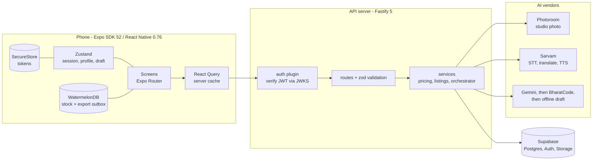
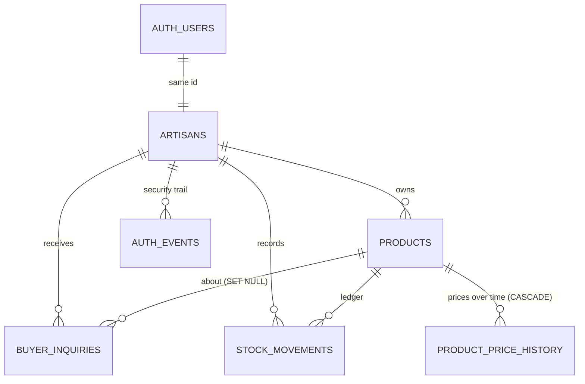
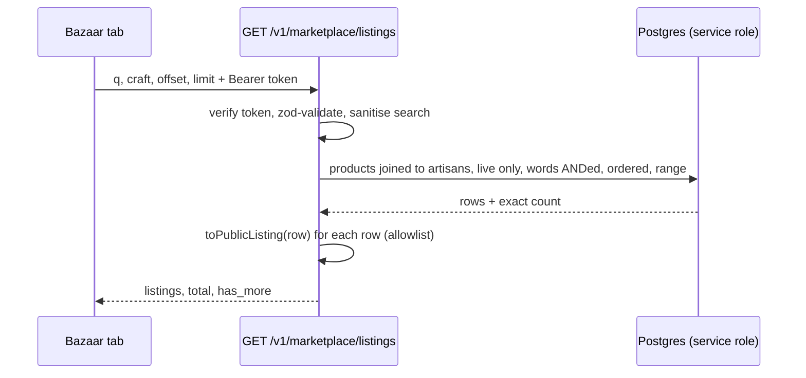

# KalaSetu AI

Voice-first mobile commerce assistant for Indian artisans, handloom weavers and
micro-entrepreneurs. Photograph a craft, describe it out loud in your own
language, and get studio photography, bilingual SEO copy, a defensible price and
one-tap syndication to ONDC, GeM and WhatsApp B2B buyers. Then browse what every
other artisan on the platform is making in the **Bazaar**.

Built for someone who does not type and may not read English. Hindi and English
are supported - exactly two, each with a real, parity-checked dictionary.

## Contents

1. [What it does](#what-it-does)
2. [Monorepo layout](#monorepo-layout)
3. [Getting started](#getting-started)
4. [Verification](#verification)
5. [System architecture](#system-architecture)
6. [Data model](#data-model)
7. [API reference](#api-reference)
8. [Mobile app architecture](#mobile-app-architecture)
9. [Accounts](#accounts)
10. [New-product pipeline](#new-product-pipeline)
11. [Product lifecycle](#product-lifecycle)
12. [The Bazaar](#the-bazaar)
13. [Offline - what is real](#offline---what-is-real)
14. [Cross-cutting design decisions](#cross-cutting-design-decisions)
15. [Security and privacy model](#security-and-privacy-model)
16. [Design system](#design-system)
17. [Deviations from the brief](#deviations-from-the-brief)
18. [Known gaps](#known-gaps)
19. [Build phase status](#build-phase-status)

## What it does

| # | Screen | Route | Job |
| --- | --- | --- | --- |
| 1 | Language, sign-up, log-in | `app/(onboarding)/` | Pick Hindi or English, then create an account by *speaking* name, craft and village; number and password are typed |
| 2 | Home - bento command center | `app/(tabs)/index.tsx` | The 01/02/03 strip (photograph, describe, price and stock); points at the next step of the current draft; spoken low-stock alert |
| 3 | Studio | `app/(tabs)/studio.tsx` | Camera, exposure grading, Photoroom cutout on a chosen backdrop, before/after slider |
| 4 | Voice | `app/(tabs)/catalog-voice.tsx` | Hold-to-talk orb; Saaras transcript, Mayura Hindi + English, Gemini listing - each stage's real output shown on a glowing timeline |
| 5 | Price | `app/(tabs)/pricing-engine.tsx` | Cost in, wholesale and retail out, with the arithmetic visible and readable aloud; saves the product |
| 6 | Stock | `app/(tabs)/inventory.tsx` | Stock grid, **voice stock adjustment** ("sold three blue cotton sarees"), QR tag per SKU, bilingual wholesale lookbook PDF |
| 7 | Market (sync hub) | `app/(tabs)/marketplaces.tsx` | Outbound: ONDC / GeM / WhatsApp-B2B payloads in one tap. Inbound: buyer inquiries, translated and read aloud |
| 8 | **Bazaar** | `app/(tabs)/bazaar.tsx`, `app/listing/[id].tsx` | **Every artisan's products** - search, filter by craft, open a listing. See [The Bazaar](#the-bazaar) |
| - | Product detail (own) | `app/product/[id].tsx` | The owner's view of one product: share pitch, QR tag, sync status, price history, make-cover, delete with undo |
| - | Edit product | `app/product/edit/[id].tsx` | Change title, description, prices, minimum quantity, tags, HSN and size. See [Product lifecycle](#product-lifecycle) |

> **Market vs Bazaar.** *Market* (tab 7) sends **your** products **out** to
> external channels. *Bazaar* (tab 8) is where you see **other artisans'** products
> **on KalaSetu**. They share no code path and no data beyond the `products` table.

## Monorepo layout

```
kalasetu-ai/
├── apps/mobile                 Expo SDK 52 · Expo Router v4 · NativeWind v4 · WatermelonDB
│   ├── app/                    File-based routes
│   │   ├── _layout.tsx           Root: splash, route guard, connectivity, background sync
│   │   ├── (onboarding)/         language-select · signup · login
│   │   ├── (tabs)/               index · studio · catalog-voice · pricing-engine · inventory
│   │   │                         · marketplaces · bazaar          (the 7-tab bar)
│   │   ├── product/[id].tsx      Owner's product screen
│   │   └── listing/[id].tsx      Bazaar listing (read-only)
│   ├── components/ui|voice|studio  Design-system primitives and feature components
│   ├── services/               apiClient · speech · session · audioRecorder · luminance ·
│   │                           costParser · catalogExports · offlineQueue · phone
│   ├── store/                  useArtisanStore · useCatalogDraftStore  (Zustand)
│   ├── db/                     WatermelonDB schema, models, sync
│   ├── i18n/                   strings (en + hi) · translate · useT
│   ├── lib/queryClient.ts      Shared React Query cache
│   ├── theme/tokens.ts         Design tokens - single source of truth
│   └── __tests__/              Jest (jest-expo)
└── services/api-server         Node 22 · Fastify 5 · Supabase
    └── src/
        ├── index.ts              buildServer(): plugins, route scopes, rate limiting
        ├── config/env.ts         Strict env contract (refuses to boot half-configured)
        ├── plugins/              auth (JWT) · error-handler (spoken error envelope)
        ├── routes/               auth · vision · speech · catalog · inventory · marketplace
        ├── services/             auth · supabase · photoroom · sarvam · gemini · bharatcode ·
        │                         catalogOrchestrator · pricing · listings · http
        ├── db/                   migrations.sql · migrations/ (numbered) · migrate.ts
        └── __tests__/            Vitest
```

## Getting started

```bash
npm install                       # workspace root
cp .env.example services/api-server/.env
cp .env.example apps/mobile/.env  # keep only the EXPO_PUBLIC_* lines

# Database (needs the direct Postgres URI, not the REST URL). Idempotent:
# safe to re-run, and re-run it after pulling - new indexes ship in this file.
DATABASE_URL='postgresql://postgres:<pw>@db.<ref>.supabase.co:5432/postgres' \
  npm run db:migrate

npm run dev                       # api-server + expo, in parallel
```

No Redis or job queue to run: every AI call is synchronous.

> **The API server must be restarted to pick up code changes** if you start it
> as `tsx src/index.ts`. `npm run dev` (`tsx watch`) reloads on save; a bare
> `tsx` process does not, and the app will get `404` for any route added since it
> started.

**Running on a phone.** The app works in **Expo Go** (`npx expo start`, scan the
QR, same Wi-Fi as the Mac). Set `EXPO_PUBLIC_API_BASE_URL` in `apps/mobile/.env`
to the Mac's LAN address - `localhost` on a phone means the phone itself. Expo
Go has no WatermelonDB native module, so the offline outbox is inert there; a
development build (`npx expo run:android`) enables it.

### iOS Simulator / device (development build)

Needs **full Xcode** (not only the Command Line Tools) and CocoaPods
(`brew install cocoapods`).

```bash
cd apps/mobile
npx expo prebuild --platform ios       # generates ios/  (gitignored)
cd ios && pod install
open KalaSetuAI.xcworkspace            # Run in Xcode; keep `npx expo start` running
```

`npx expo run:ios` should also work once `xcode-select` points at Xcode
(`sudo xcode-select -s /Applications/Xcode.app`); until then it fails with
"Can't determine id of Simulator app". (The steps above were the ones verified:
`xcodebuild` with `DEVELOPER_DIR` set, then installing onto the Simulator.)

**With Xcode 27 / the iOS 27 SDK the generated project needs four hand edits.**
They live in `apps/mobile/ios/`, which is gitignored and regenerated by
`prebuild`, so `expo prebuild --clean` **discards them** - re-apply, or turn them
into an Expo config plugin:

| File | Edit | Why |
| --- | --- | --- |
| `ios/Podfile` | `pod 'simdjson', path: '../../../node_modules/@nozbe/simdjson', modular_headers: true` after `use_native_modules!` | WatermelonDB depends on the npm-vendored simdjson, not the CocoaPods one |
| `ios/Podfile` `post_install` | Raise any pod `IPHONEOS_DEPLOYMENT_TARGET` below 15.1 to 15.1 | Xcode 27 rejects targets below 15.0 (e.g. SDWebImage declares 9.0) |
| `ios/Podfile` `post_install` | Build the `fmt` pod with `CLANG_CXX_LANGUAGE_STANDARD = c++17` | fmt's C++20 `consteval` use fails on the new Clang |
| `ios/KalaSetuAI/AppDelegate.mm` + `Info.plist` | Add a `SceneDelegate`, a `configurationForConnectingSceneSession` override, and a `UIApplicationSceneManifest` | The iOS 27 SDK aborts at launch (`EXC_BREAKPOINT` in `UIApplicationEvaluateRuntimeIssueForNoSceneLifecycleAdoption`) for apps that do not adopt the UIScene lifecycle |

Expo SDK 52 / React Native 0.76 predate iOS 27; these edits make it run, but
upgrading Expo is the durable fix.

**Simulator console noise.** `AudioCodecInitialize failed` (the Simulator has no
real audio codec) and `AVAudioSession ... can lead to UI unresponsiveness if
called on the main thread` (an `expo-av` advisory) are log warnings, not crashes.
The lime ring is the splash screen, held until the stores finish hydrating.

### Required credentials

| Variable | Service | Used for |
| --- | --- | --- |
| `PHOTOROOM_API_KEY` | Photoroom Image Editing API v2 | Background removal, AI relight, soft shadow (best quality; needs credits) |
| `STUDIO_ENGINE` | — (optional) | `auto` (default): Photoroom, falling back to the free built-in engine · `local`: never call Photoroom · `photoroom`: never fall back |
| `SARVAM_API_KEY` | Sarvam AI | Saaras V4 STT, Mayura translate, Bulbul V4 Flash TTS |
| `GEMINI_API_KEY` | Google Gemini | Structured bilingual catalog + pricing (model chain, see `gemini.service.ts`) |
| `BHARATCODE_API_KEY` | BharatCode (optional) | Fallback LLM when Gemini is overloaded |
| `SUPABASE_URL` / `SUPABASE_SERVICE_ROLE_KEY` | Supabase | Postgres, Auth admin, media storage |
| `SUPABASE_PUBLISHABLE_KEY` | Supabase | Password sign-in and refresh (falls back to the secret key) |

Optional tuning, with defaults (`config/env.ts`): `GEMINI_MODEL`,
`BHARATCODE_BASE_URL` / `BHARATCODE_MODEL`, `SUPABASE_STORAGE_BUCKET`
(`kalasetu-media`), `PORT` (`8080`), `HOST`, and the pricing constants
`SKILL_RATE_INR_PER_HOUR` (95), `PACKAGING_COST_INR` (45), `WHOLESALE_MARGIN`
(0.28), `RETAIL_MARGIN` (0.95). The mobile app reads `EXPO_PUBLIC_API_BASE_URL`,
`EXPO_PUBLIC_SUPABASE_URL` and `EXPO_PUBLIC_SUPABASE_ANON_KEY`.

## Verification

```bash
npm test          # backend (vitest) + mobile (jest)
npm run typecheck # tsc --noEmit, both workspaces, strict
```

**197 tests**: 113 backend (8 files) and 84 mobile (8 suites).

The backend suite includes the security properties, not just the happy path:
every protected route 401s with no token, forged / expired / wrong-issuer /
service-role tokens are rejected against a locally-signed key, and media-URL
ownership (own upload accepted; another artisan's, a `file://` path, a foreign
host and `..` traversal all rejected). The mobile suite pins the auth client
(one shared refresh, no logout on a dropped connection) and the regressions
listed under *Pipeline bugs fixed* below.

| Suite | Covers |
| --- | --- |
| `auth.test.ts` (41) | Phone normalisation, JWT verification, media ownership, 401 on every protected route (including the Bazaar's) |
| `listings.test.ts` (26) | The Bazaar: public-field allowlist, search sanitising, per-word search, routes against a faked Supabase |
| `model-fallback`, `ai-fallbacks`, `catalog-orchestrator` | Gemini model chain, BharatCode fallback, offline draft, vendor outages |
| `pricing`, `voice-stock`, `marketplace-adapters` | Cost-plus maths, spoken stock parsing, ONDC/GeM/WhatsApp payloads |
| mobile `apiClient`, `speech`, `draftStore`, `i18n`, ... | Token refresh, TTS cancellation, draft store, en/hi parity, the Bazaar's query building |

**What the tests do not prove.** The Bazaar route tests fake Supabase, so they
cannot show that PostgREST accepts the `artisans!inner(...)` embed, the
`artisans.craft_category` filter or the repeated `or(...)` groups. Those were
checked by hand against the dev project (including Devanagari and hostile
search input) but there is no automated integration test. Screens have no render
tests; UI behaviour is checked by running the app.

## System architecture



- **The phone never holds an AI key.** Photoroom, Sarvam, Gemini and BharatCode
  are reached only through the API server, which also holds the Supabase
  service-role key. The phone holds the Supabase *anon* key and the artisan's own
  session tokens.
- **Everything is synchronous.** There is no queue, worker or Redis: each AI call
  runs inside the request that asked for it, and the mobile app awaits the result.
- **Request lifecycle** (`src/index.ts`): `onRequest` authentication (public,
  optional or required, by route scope) -> `preHandler` rate limit, keyed on the
  *verified* artisan id and falling back to IP -> zod validation -> handler ->
  the shared error envelope (`plugins/error-handler.ts`).
- **Route scopes** are the access-control model: `/v1/auth/*` is public,
  `/v1/speech/*` is *optional-auth* (onboarding speaks before an account exists),
  and everything else sits behind `authenticate`.

| Concern | Choice |
| --- | --- |
| Mobile | Expo SDK 52, React Native 0.76 (new architecture on), Expo Router v4 (typed routes), NativeWind v4 |
| Graphics / motion | `@shopify/react-native-skia` for glows and waveforms, Reanimated 3 for timelines |
| Client state | Zustand (session, profile, draft) + TanStack Query (server data) |
| Local DB | WatermelonDB over SQLite - needs a development build, absent in Expo Go |
| Server | Fastify 5, zod, `jose` for JWT, `@fastify/rate-limit`, `@fastify/multipart` |
| Backend services | Supabase Postgres + Auth + Storage; Photoroom; Sarvam; Gemini (+ BharatCode) |
| Build | npm workspaces + Turborepo; TypeScript 5.6 strict with `noUncheckedIndexedAccess` |

## Data model



Defined in [`services/api-server/src/db/migrations.sql`](services/api-server/src/db/migrations.sql).

| Table | Notes |
| --- | --- |
| `artisans` | `id` **is** the Supabase auth user id. Phone (E.164, unique), name, `preferred_language`, `craft_category`, `cluster_location`, `gi_tag_certified` |
| `products` | Bilingual title/description, `seo_tags`, `hsn_code`, cost inputs (`material_cost_inr`, `labor_hours`), `dimensions_cm` (JSONB), two prices + MOQ, `stock_quantity`, `marketplace_sync_status` (JSONB), raw/enhanced image URLs, optional voice note + transcript, soft-delete `deleted_at` |
| `buyer_inquiries` | Inbound B2B messages with the source language, requested quantity, offered price, status |
| `stock_movements` | Audit ledger of every voice/manual/order/sync adjustment |
| `auth_events` | Security trail: signup, login, failed login, logout, password change. Created by migration `010`; see [Account security](#account-security) |
| `product_price_history` | One row each time a product is created or either price changes: retail, wholesale, `source` (`create` / `edit` / `system`), `changed_at`. Written by a database trigger only. Migrations `020` and `021`; see [Product lifecycle](#product-lifecycle) |

- **Cascades.** Deleting an artisan removes their products, inquiries and stock
  movements; account deletion also removes their storage objects, then the auth
  user last (so a partial failure leaves a retry-able account).
- **`updated_at`** is maintained by a trigger *and* set explicitly by stock and
  sync writes. It therefore means "last changed", not "first listed" - which the
  Bazaar's ordering inherits.
- **Indexes.** `products (artisan_id, updated_at DESC)` for the owner's grid,
  a partial index for low stock, and `products (updated_at DESC, id) WHERE
  deleted_at IS NULL` (`products_market_idx`) for the Bazaar's cross-artisan paging.
- **Row-level security.** Every table has an owner-only policy
  (`auth.uid() = artisan_id`). The API server uses the **service-role key, which
  bypasses RLS**, so for server routes RLS is a backstop and every query must
  scope itself. See [Security and privacy model](#security-and-privacy-model).
- **Media** lives in one Supabase Storage bucket under
  `<artisanId>/<raw|enhanced|voice>/<uuid>.<ext>`; the path prefix *is* the
  ownership check.

## API reference

All routes are under the server's base URL. Errors share one envelope (below).

| Access | Method + path | Purpose |
| --- | --- | --- |
| Public | `GET /health` | Liveness, uptime |
| Public | `POST /v1/auth/signup` · `/login` · `/refresh` | Credentials in, session out (10/min per IP) |
| Optional auth | `GET /v1/speech/languages` | The two supported languages |
| Optional auth | `POST /v1/speech/transcribe` · `/translate` · `/bilingual` · `/speak` | Saaras STT, Mayura, Hindi+English in one call, Bulbul TTS (40/min anonymous, 240/min signed in) |
| Auth | `GET` · `PATCH` · `DELETE /v1/me` | Profile; delete account and everything it owns |
| Auth | `POST /v1/auth/logout` | End this session on the server (`all_devices: true` ends every session) |
| Auth | `POST /v1/me/password` | Change password: verifies the current one, ends other sessions (5/min) |
| Auth | `GET /v1/me/activity` | The artisan's own security trail, newest first, paged |
| Auth | `GET /v1/me/export` | Everything stored about the artisan, as a JSON download (3/min) |
| Auth | `GET /v1/vision/backdrops` · `POST /v1/vision/edit` | Backdrop presets; studio edit -> hosted URLs (`engine`, `fallback_reason` say how) |
| Auth | `POST /v1/vision/media/remove` | Discard photos dropped from a draft (never one a saved product uses) |
| Auth | `POST /v1/catalog/generate` | Gemini listing from a stored image URL + transcript |
| Auth | `POST /v1/catalog/price` | Deterministic pricing breakdown + spoken rationale |
| Auth | `POST /v1/catalog/products` | Commit an approved draft (URLs must be the caller's own uploads) |
| Auth | `GET` · `PATCH` · `DELETE /v1/catalog/products/:id` | One of your products; change chosen fields; delete it reversibly. Not yours, or already deleted: `404` |
| Auth | `POST /v1/catalog/products/:id/restore` | Undo a delete |
| Auth | `GET /v1/catalog/products/:id/price-history` | Past prices, newest first, each with its change from the one before; `limit` (1-50, default 20), `before` cursor |
| Auth | `POST /v1/catalog/products/:id/retranslate` | Translate the title and description from one language into the other; preview unless `apply` (10/min) |
| Auth | `GET /v1/inventory` | The caller's stock grid, low-stock list, total value |
| Auth | `PATCH /v1/inventory/:productId/stock` | Absolute set or relative delta |
| Auth | `POST /v1/inventory/voice-adjust` | "Sold 3 blue cotton sarees" -> fuzzy match -> decrement |
| Auth | `GET /v1/inventory/:productId/qr` | Printable QR tag as a PNG data URL |
| Auth | `POST /v1/inventory/low-stock-alert` | Spoken low-stock summary |
| Auth | `POST /v1/marketplace/export` | Build ONDC / GeM / WhatsApp-B2B payloads; record sync state |
| Auth | `GET /v1/marketplace/status` · `/inquiries` | Sync counts; buyer inquiries, translated and optionally voiced |
| Auth | **`GET /v1/marketplace/listings`** | **Bazaar: every artisan's products** - `q`, `craft`, `limit` (1-50, default 20), `offset` (0-10000) |
| Auth | **`GET /v1/marketplace/listings/:id`** | **One Bazaar listing** (id must be a UUID) |
| Auth | **`GET /v1/marketplace/crafts`** | **Craft filter chips**, with product counts |

**Error envelope** (every route):
`{ error, message, spoken_hi }`. `spoken_hi` is a short sentence in the language of
the `X-Lang` request header (the field keeps its name from the Hindi-only first
version) that the client feeds to TTS. Validation failures are `400`
`validation_failed` with per-field `issues`; an upstream vendor failing is `502`,
split into `upstream_unavailable` (their outage - blame the connection) and
`upstream_rejected` (we sent something wrong - do not).

## Mobile app architecture

**Routing.** Expo Router, file-based. `app/_layout.tsx` holds the splash screen
until the stores hydrate, then runs the **route guard keyed on the session**
(no session -> onboarding group; session -> tabs). Being signed in is holding a
valid login; the profile is just data that can be re-fetched, and is rebuilt from
`/v1/me` if the cache was lost. The same layout polls connectivity every 20 s and
starts background sync once a profile exists.

**State, split by what it is.**

| State | Where | Why |
| --- | --- | --- |
| Tokens | `services/session.ts` -> SecureStore (Keychain / Keystore) | A refresh token is a long-lived credential; it must not sit in a backup-able file |
| Profile, language, preferences | `useArtisanStore` -> JSON file | Not secret |
| In-flight product draft | `useCatalogDraftStore` | One product crosses four screens and must survive backing out; nothing is sent until commit. Holds **hosted URLs, never image bytes** |
| Server data | TanStack Query (`lib/queryClient.ts`) | Fresh for 60 s, retry twice with backoff, no refetch on focus, kept 24 h; **cleared on sign-out** because several people share a phone |

Screens read Zustand with **selectors** and use `getState()` in callbacks;
subscribing to the whole store re-rendered on every `set` and caused the pricing
screen's request loop (see *Pipeline bugs fixed*).

**API client** (`services/apiClient.ts`). Typed, one place for every endpoint.

- Attaches the bearer token and `X-Lang` to every call.
- **Refreshes proactively** when the token is about to expire, and once on a `401`;
  concurrent calls **share one refresh** (single-flight). Only a *definitive*
  `401` from the refresh endpoint ends the session - a phone that is simply
  offline or a `503` never logs anyone out.
- Failures become a structured `ApiError` carrying the spoken sentence. A
  **timeout and a dead connection are reported separately**, and neither claims
  work was saved.

**Spoken UI** (`services/speech.ts`). Every action can be heard, so this module is
hot. A disk cache keyed by (text, language) means each prompt is synthesised once
per device, then replays offline; one reusable `Audio.Sound` is unloaded between
plays (stacked sounds leak handles on a budget Android); each `speak()` claims a
session id **synchronously** and re-checks it after every `await`, so a newer
sentence, the microphone or an unmount cancels a line still loading. Nothing
plays while recording.

**i18n** (`i18n/`). Two real dictionaries, `en` and `hi`. A compile-time check
(`HI_HAS_EVERY_KEY`) fails the build if Hindi lacks a key English has; otherwise
an artisan who may not read English would see English text, read aloud by a Hindi
voice. `tFor(lang)` returns a **stable
function per language** - an unstable `t` in `useEffect` dependencies re-fired
spoken prompts on every render. The same strings are shown *and* spoken, so they
are written to sound natural aloud.

**Tabs.** Seven: Home, Studio, Voice, Price, Stock, Market, Bazaar. Icons are 24px
with a 3px lime underline for the active tab (visible in sun where a tint change
is not), the bar is tall for thumb use, and **long-pressing a tab speaks its
name**.

## Accounts

Identity is a **mobile number and password**, backed by Supabase Auth.

Supabase's own phone login needs an SMS provider this project does not have, and
its email login sends confirmation mail through a shared sender capped at a few
messages an hour. So the server creates *pre-confirmed* accounts through the
admin API, keyed on a deterministic internal address derived from the phone
number (`91XXXXXXXXXX@phone.kalasetu.invalid` - `.invalid` is reserved by
RFC 2606 and can never receive mail, so it is a login key, never a contact
channel).

- **Tokens** are Supabase's ES256 JWTs, verified locally against the project's
  public JWKS: no network call per request and no shared secret on the server.
- **Identity comes only from the token.** No route reads an artisan id from the
  query or body; before accounts, any caller could read or change any catalog by
  sending a different UUID. Inventory, QR tags, stock changes and re-edits are
  all scoped to the caller.
- The artisan row's id **is** the auth user's id, which is what makes the
  `auth.uid() = id` row-level-security policies mean something.
- Sign-out wipes the query cache and the in-progress draft, because several
  people share a phone.
- **Account deletion** is in the app (Google Play requires it): it removes the
  login, the profile, every product and every stored photo and voice note.
- Tokens are held in the platform keystore (SecureStore), not the profile file.

**Known gap: there is no password recovery.** That needs real phone OTP, which
needs an SMS provider (MSG91, Twilio). Until then a forgotten password means a
new account. Passwords are Supabase's (minimum 6 characters).

Anonymous callers can reach only the speech endpoints, because the onboarding
screens speak and transcribe before an account exists. They are rate-limited per
IP (40/min vs 240/min signed in) since every call spends Sarvam credits.

### Account security

This is the account module's work on top of sign-in: an audit trail, a real logout,
password change, profile editing and a data export. Everything here identifies the
caller **only** from the token.

| Endpoint | What it does |
| --- | --- |
| `POST /v1/auth/logout` | Revokes this session through the Supabase admin API, so a lost or stolen copy of the token stops working. `{ "all_devices": true }` ends every session. `204`; `502` if revocation failed (the app logs out on the phone regardless). Needs a token. |
| `POST /v1/me/password` | `{ current_password, new_password }`. Verifies the current password first: a valid token only proves the phone was unlocked. Refuses a weak (under 6) or unchanged password, sets the new one, ends every *other* session. 5 attempts a minute. |
| `GET /v1/me/activity?limit=&before=` | The artisan's own events, newest first. `limit` 1-50 (default 20); `before` is the previous page's `next_before`. Network addresses are masked (`203.0.113.x`). |
| `GET /v1/me/export` | Profile, products, stock movements, inquiries received and sent, and security events as one JSON attachment. Each list is capped at 5,000 rows and a capped list is named in `truncated` rather than passed off as complete. 3 a minute. |

**Errors.** `wrong_password` and `same_password` are `400`, never `401`: the mobile
client treats a 401 as an expired session and would log the artisan out for a
mistyped current password. Every error has a real Hindi and English sentence
(`AUTH_SPOKEN`, covered by a test).

**The audit trail** (`auth_events`, migrations `010` and `011`):

- Events: `signup`, `login`, `login_failed`, `logout`, `password_changed`, each with
  the caller's address and a length-capped user agent.
- **Written by the server only.** Row-level security lets an artisan *read* their
  own events and nothing else, and INSERT/UPDATE/DELETE are revoked from the public
  roles: a trail its subject can edit is not a trail.
- Writes are **not awaited**, so recording can neither slow nor break the action it
  records. This also keeps the login's "same answer for a wrong password and an
  unknown number" guarantee safe against timing: the lookup that attaches a failed
  attempt to an account runs after the response is sent.
- Deleting an account deletes its trail (`ON DELETE CASCADE`).
- A real client address needs `TRUST_PROXY=true` behind a proxy such as Render (the
  Blueprint sets it). It is off by default because trusting a forwarded header on a
  directly reachable server lets a caller claim any address.

**Applying the migrations.** Paste `010_auth_events.sql` and then
`011_auth_events_security.sql` (in `services/api-server/src/db/migrations/`) into the
Supabase SQL editor, or run `npm run db:migrate` with `DATABASE_URL` set. Then paste
`migrations/verify/010_011_smoke.sql`: it prints `ALL CHECKS PASSED` (and rolls back,
so it leaves nothing behind). Until the migrations are applied the app keeps working:
no events are recorded, the activity list is empty and the export's security list is
empty.

**On the phone.** *Account* on the home screen now offers Edit profile (name, craft,
village: only changed fields are sent), Change password (current + new twice, live
strength bar, per-field errors), Account activity (plain-language trail, with a
warning and a shortcut to Change password after three wrong-password attempts in 24
hours), Log out (server-side, capped at 2.5 s so a slow link never blocks logging out
of the phone), Log out of all devices, and Download my data (written to a file, shared,
then deleted from the cache because it holds personal data). The mobile number is shown
but cannot be changed: it is the login, and changing it needs a verified phone.

**Tests** (246 backend in 22 files, 170 mobile in 14 suites at the time of writing):
service tests for audit, password change and export; route tests for each endpoint;
`account-isolation.test.ts`, which calls every endpoint as two different people while
the request names a third, and was checked by mutation (making `PATCH /v1/me` trust a
body id, or the export a query id, fails it); `account-journey.test.ts`, which runs
sign up, a wrong password, login, password change, paged activity, export and logout
against a small in-memory database; and the SQL smoke test above.

**Limits.** No password recovery (needs an SMS provider). No alert is sent when
someone guesses a password: the warning appears when the artisan next looks at their
activity. Events are kept until the account is deleted.

## Studio photos

`POST /v1/vision/edit` chooses an engine (`STUDIO_ENGINE`, default `auto`):

| Engine | What it does | Cost |
| --- | --- | --- |
| **Photoroom** | Segmentation, AI relight, physically placed shadow, 1600px PNG | Paid credits |
| **Built-in** (`local-studio.service.ts`) | Background removal in-process (`@imgly/background-removal-node`, ONNX), tone lift only as far as the photo needs, product centred on a square backdrop with a soft drop shadow, 1600px JPEG | Free; ~2-4 s and **~1.4 GB peak memory** per photo (needs a 2 GB instance; on a smaller one it declines and the original photo is returned, flagged) |

The built-in engine is an approximation, not a clone: the cutout is good, but the
lighting is a global tone correction and the shadow is a blurred silhouette. Set
`STUDIO_ENGINE=local` to stop spending Photoroom credits, or leave `auto` to get
Photoroom quality while credits last. A Photoroom 401/402/403 is remembered for
10 minutes (an outage for 1) so each photo does not first pay a round trip to learn
what is already known. The built-in engine runs one photo at a time with a short
queue; past that it sheds load and the app shows the original, flagged.

**Several photos per product.** The Studio screen has a *More photos* strip
(camera or gallery, up to 5 extras). Each extra goes through the same studio
pipeline, and changing the backdrop/relight/shadow re-styles them so the gallery
looks like one shoot. The cover is `enhanced_image_url`; extras are
`gallery_image_urls`, validated as the caller's own uploads, and appear in the
product detail screen, the WhatsApp pitch and the ONDC/GeM payloads. **Needs the
`gallery_image_urls` column** — run the last statement of `db/migrations.sql` in the
Supabase SQL editor. Until then products still save, without the extras, and the
app says so.

## New-product pipeline

Photo -> studio -> voice -> listing -> price -> save. Media never passes through
the phone as bytes after the first upload:

1. The capture is **downscaled to 1600px** on the phone (a raw 12MP frame is
   4-6MB; Photoroom's output is capped at 1600px anyway).
2. `POST /v1/vision/edit` uploads it, runs the studio engine (below), stores the
   result, and returns **hosted URLs**. Re-edits (backdrop, relight, shadow) send
   `raw_image_url` instead of the photo, and the replaced render is deleted.
3. The voice note is transcribed and stored (`?store=true`).
4. `POST /v1/catalog/generate` takes the stored image **URL** - the server
   fetches it itself - and returns the listing. Costs and size are optional
   here: they are not known yet, and are never invented.
5. `POST /v1/catalog/products` accepts only URLs the server handed out for
   *that artisan*.

Saving a product also invalidates the inventory, marketplace-status and Bazaar
caches, so it appears everywhere at once.

### Pipeline bugs fixed

- Spoken prompts **re-fired on every re-render** (an unstable `t` in `useEffect`
  deps) - the profile screen re-spoke its question on each keystroke.
- The pricing screen made a **request loop** (~every 420ms): it depended on the
  whole store object, which changes on every `set`, including its own write.
- Studio backdrop/relight/shadow changes re-ran the edit with the **previous**
  setting (stale closure), and `"false"` parsed as `true` server-side
  (`z.coerce.boolean`), so the toggles never worked at all.
- Products were saved with **on-device `file://` paths** as their photos; the
  voice note was never uploaded; zero dimensions were sent (a 400 at the last
  button); the saved product did not appear in inventory for a minute.
- The AI was fed **invented dimensions** (a padded 30x20x2) and wrote them into
  listings; pricing was computed from zero costs and shown before any were
  entered.
- A timeout was reported as "offline", and the offline message claimed the work
  was "saved on the phone" - it was not.
- `en-IN` transcripts were "translated" `en-IN -> en-IN`.
- Out-of-order price responses could overwrite newer ones; a stale price could
  be committed before its recalculation landed; the Studio tab stayed on an
  empty stage after a save; stock quantity was hard-coded to 1.

## Product lifecycle

After a product is saved it can be looked at, corrected, re-priced and deleted - and
every one of those is the artisan's own and nobody else's.

```
GET    /v1/catalog/products/:id                 one product
PATCH  /v1/catalog/products/:id                 change chosen fields
DELETE /v1/catalog/products/:id                 hide it (reversible)
POST   /v1/catalog/products/:id/restore         bring it back
GET    /v1/catalog/products/:id/price-history   past prices
POST   /v1/catalog/products/:id/retranslate     Hindi <-> English
```

### Ownership

Identity comes only from the verified token. The service-role key bypasses RLS, so
every query in `product.service.ts` filters by the artisan it was called for, and a
product that belongs to someone else is a plain `404` - the same answer as one that
does not exist, so ids cannot be probed. Request bodies are `.strict()`: an
`artisan_id` (or anything else not listed below) is refused with a `400`, not ignored.

### Editing (`PATCH`)

Editable: `title_en/hi`, `description_en/hi`, `seo_tags`, `hsn_code`, `material_cost_inr`,
`labor_hours`, `recommended_retail_inr`, `recommended_wholesale_inr`, `min_wholesale_qty`,
`dimensions_cm` (any measurement on its own), and the photos (below). Send at least one
field; only the columns that actually changed are written.

- **Stock is deliberately not editable here.** It changes through the inventory screens,
  so every change leaves a row in `stock_movements`. A `stock_quantity` in the body is a `400`.
- **Retail must stay above wholesale**, checked against the values the product will have
  *after* the edit - so changing only the wholesale price cannot push it over the retail one.
- **Tags** are lower-cased and de-duplicated (at most 30, each up to 40 characters).
- **Photos can only be rearranged or removed, never added or swapped for a URL the
  product does not already have.** `cover_image_url` promotes one of the extra photos (the
  old cover takes its place in the gallery); `gallery_image_urls` sets the order and drops
  any left out, up to 5. A photo that is no longer part of the product is deleted from
  storage afterwards, best-effort, and only paths under the caller's own folder.

### Deleting and restoring

`DELETE` sets `deleted_at`; nothing is erased, so `POST .../restore` brings the product back
exactly as it was. Deleting an already-deleted product, or restoring one that is not
deleted, is a `404`. The Bazaar already leaves deleted products out.

### Price history

A **database trigger** (`products_log_price`) writes a row when a product is created and
whenever either price actually changes - not in the API, so a price changed any other way
(the SQL editor, a future feature) is recorded too. A stock sale or a new title writes
nothing. Products that existed before the trigger get one `system` row for the price they
have now, so their history does not start empty (earlier prices are not recoverable).

The table is readable only by the product's owner (RLS through `products.artisan_id`) and
its write privileges are revoked from the public roles. The endpoint returns each row with
`retail_change` / `wholesale_change` against the row before it, paged by a time cursor
(`next_before`).

### Re-translation

`POST .../retranslate` with `{ "from": "en-IN" | "hi-IN", "apply": false }` translates the
title and description with the same Sarvam model the listing is first written with.

- It **previews by default**; nothing is overwritten until `apply: true`.
- It writes **only the other language's fields** and never the one translated from.
- Text is cut into pieces of at most 900 characters (at sentence ends, including the Hindi
  danda, then at words) and sent **one at a time**. If any piece fails the whole request
  fails with a `502` and **nothing is saved** - there is never a half-translated product.
- A field with no source text is skipped rather than overwritten with nothing.

### On the phone

- `app/product/edit/[id].tsx` with `components/ui/ProductForm.tsx`. All checking is in
  `services/productForm.ts` (pure, tested): it accepts Hindi digits, a rupee sign and
  `1,20,000`-style commas, reports every problem at once in the artisan's language, and
  sends only what changed. Leaving with unsaved changes asks first.
- The product screen gains **delete with undo**, a **price-history card**, and **make this
  the cover photo** on any photo that is not the cover.
- The client methods `getProduct`, `updateProduct`, `deleteProduct`, `restoreProduct`,
  `priceHistory` and `retranslateProduct` are in `services/apiClient.ts`.

### Applying the migrations

Run `020_price_history.sql` then `021_price_history_trigger.sql` (Supabase SQL editor, or
`npm run db:migrate`). The API works before they are applied - the price-history endpoint
answers with an empty list instead of failing - but nothing is recorded until they are.
`migrations/verify/020_021_smoke.sql` is a rollback-safe check that the trigger, the
backfill, the RLS policy and the revoked privileges behave as described.

### Tests

161 new backend tests (`product.service`, `products-routes`, `retranslate`,
`retranslate-failures`, `product-invariants`, `products-isolation`) and 95 new mobile tests
(`productClient`, `productForm`, `productLifecycle`). They include seeded random invariants
(no photo is ever lost, invented or duplicated; price changes add up to newest minus oldest;
no translation chunk exceeds its limit), a sweep that calls every endpoint as two different
artisans while naming a third, and the failure cases for the translator. Each group was
checked by breaking the code on purpose and confirming a test failed.

## The Bazaar

The rest of the app is one artisan looking at their own stock. The Bazaar is the
outward-facing half: the products every other weaver, potter and metalworker on
KalaSetu has listed, so an artisan can see the market they sell into, price
against it, and find work to buy or resell.



### What other artisans see - and what they never do

The API server's service-role key **bypasses row-level security**, and the RLS
policies are owner-only. So the Bazaar cannot be a direct client read, and RLS
cannot be what protects an artisan's private data on this path. The guarantee
lives in code: [`listings.service.ts`](services/api-server/src/services/listings.service.ts)
builds each listing **field by field from an allowlist**, never by spreading the
row. A column added to `products` tomorrow is private until someone adds it there.

| Data | Owner | Other artisans in the Bazaar |
| --- | :---: | :---: |
| Title, description (Hindi + English), enhanced photo, SKU, HSN, tags, dimensions | yes | yes |
| Retail price, wholesale price, MOQ, stock count | yes | yes |
| Seller name, craft, cluster / village, GI-certified flag | yes | yes |
| Material cost, labour hours (the cost basis behind the price) | yes | **no** |
| Raw photo, voice note, transcript | yes | **no** |
| Marketplace sync status | yes | **no** |
| Seller's phone number | yes | **no** |

Seller identity (name, craft, place) being visible to other signed-in artisans is
a product decision, not an accident: it is what makes a marketplace useful. A
test asserts the exact key set of a listing and that none of the private fields
appear anywhere in the serialised response.

### Behaviour

- **Scope.** Every live product (`deleted_at IS NULL`) from every artisan,
  including your own - which are marked **Yours**. Sold-out products are shown,
  labelled **Sold out**, not hidden.
- **Ordering.** Most recently *updated* first (`updated_at DESC, id`). The `id`
  tie-break keeps a page boundary from repeating or skipping rows that share a
  timestamp. Because a stock change or marketplace sync also bumps `updated_at`,
  an edited product moves to the top.
- **Search.** The box is split into up to 4 words (60 characters max). **Each word
  is matched independently and the words are ANDed**, so "saree silk" finds
  "Banarasi Silk Saree". A word matches if it appears (case-insensitive substring)
  in the English title, the Hindi title or the SKU, **or** is exactly one of the
  product's tags. Devanagari works.
- **Craft filter.** Chips come from `GET /crafts`, counted from *products* so a
  chip never leads to an empty list. Choosing one filters on the seller's
  `craft_category` (an inner join); tapping it again clears it.
- **Paging.** Offset paging, 20 per page (max 50, offset capped at 10 000), exact
  total returned, "Show more" button. The client de-duplicates by id across pages,
  because offset paging can repeat a row when someone lists a product mid-scroll.
- **Safety of the search box.** The term is spliced into a PostgREST `or(...)`
  filter, which is a mini-language: a comma starts a new condition, parentheses
  and colons are syntax, `%` and `_` are LIKE wildcards. `sanitizeSearch` turns
  those into spaces first, so a stray comma can neither rewrite the query nor 400.
- **Detail.** `app/listing/[id].tsx` is deliberately separate from
  `product/[id].tsx`: that one reads the owner's own inventory and carries the
  owner's tools (stock adjustment, QR tag, wholesale share); someone else's
  product has none of those. For your *own* product the listing offers a link
  across to the owner screen.

### Client behaviour

- Query keys `['bazaar', 'listings' | 'crafts' | 'listing', ...]`, each including
  the signed-in artisan, so one login's view can never serve another's.
- Typing is debounced 350 ms and uses `keepPreviousData`, so the list does not
  flash empty on every keystroke. Opening a listing shows the cached copy
  instantly and refreshes it behind.
- Focus refetches **only if the data is stale** - not on every tab switch, which
  with many pages loaded would be a request storm on a slow link.
- Saving a product, and changing stock (voice or +/-), invalidate the Bazaar.
- Sign-out clears the whole cache.

### Limits worth knowing

- **No way to contact a seller yet.** The phone number is deliberately withheld,
  and there is no in-app inquiry from the Bazaar. The natural next step is a
  "send inquiry" that writes a `buyer_inquiries` row for the seller (the existing
  inbound feed already translates and reads those aloud).
- `GET /crafts` reads at most 5 000 product rows and counts them in JS. Fine at
  this scale; the place to switch to a SQL `GROUP BY` view.
- The `products_market_idx` index ships in `migrations.sql`. The endpoint works
  without it, just slower on a large catalog; run `npm run db:migrate` to apply it.

## Offline - what is real

Be clear-eyed about this one. The WatermelonDB layer ([`apps/mobile/db/`](apps/mobile/db/))
and outbox ([`services/offlineQueue.ts`](apps/mobile/services/offlineQueue.ts))
exist, but **no screen reads the local database**, and the outbox holds only two
replayable jobs: `marketplace_export` and `stock_delta`. The new-product pipeline
is **online-only** and fails honestly ("no internet, try again") when offline.

An earlier version queued the pipeline's steps and told the artisan their work
was saved. It was not: each job needed a local product row nothing created. Real
offline capture is a feature, not a few job handlers - local draft rows, a media
upload queue, conflict handling - and needs a development build to test.

Two further facts about the sync engine ([`db/sync.ts`](apps/mobile/db/sync.ts)):
its **pull is a full `GET /v1/inventory`**, reconciled locally - `lastPulledAt` is
recorded but the server has no `since` filter, so this is not yet a delta sync -
and the conflict policy is deliberately asymmetric: the server wins on
AI-generated copy and prices, the **local value wins on `stock_quantity`** (the
artisan physically handed over the goods), reconciled by replaying unsynced
deltas on top of the server count. The header comment in `db/schema.ts`
("the Postgres copy is a replica of it") describes the original ambition, not
what is wired today.

## Cross-cutting design decisions

**The pricing floor is deterministic, never AI** ([`pricing.service.ts`](services/api-server/src/services/pricing.service.ts)).
Cost-plus math owns the floor; Gemini's market benchmark can only raise the
ceiling, blended 60/40, and is discarded outright if it would price below the
artisan's own cost. Artisans in these clusters are routinely talked down by
middlemen, so the full breakdown is visible and `explainPricing` reads it aloud, in the artisan's language:
a price you can explain is a price you can hold.

```
Base      = material + (labour hours x skill rate) + packaging
Wholesale = Base x (1 + 0.28)        Retail = Base x (1 + 0.95)     (defaults)
```

Skill rate starts at INR 95/hour and rises 9% per point of visual intricacy above
5 (a 10/10 brocade hour is worth about 1.45x a plain one). Packaging is a flat
INR 45 plus a volumetric surcharge **capped at INR 180**, because raw dimensions
lie for textiles: a saree is catalogued at its 550 cm woven length but ships
folded in a polybag.

**Every AI vendor has a working fallback.** Photoroom out of credits or down → the
built-in studio engine takes over (below); only if that fails too does the
original frame come back, flagged, with a message that says what happened. Gemini down → BharatCode, then a
draft built from the transcript alone. Sarvam TTS down → the alert still ships,
silently. A `429`/`5xx` retries with jittered backoff; a `401` fails fast
instead of burning the artisan's battery on a bad key.

- **Gemini walks a model chain** (the configured model, then known alternates)
  because Google retires model ids *per key*. A `404`, `429` or `503` moves to the
  next model; a `400` or `401` is *our* fault and is never masked by the chain.
- **BharatCode** (an OpenAI-compatible second vendor) is tried only after the
  whole Gemini chain has failed - a safety net in a different failure domain, never
  raced and never first. If both fail the route returns an offline draft with
  `degraded: true`.
- **Retry policy** (`services/http.ts`): up to 3 attempts, 30 s timeout, exponential
  backoff with jitter on transport errors and `408/425/429/5xx`; other `4xx`
  surface immediately.

**Errors speak.** Every API error carries a `spoken_hi` field (named for the
original Hindi-only version; it is in the language of the `X-Lang` header) that
the client feeds straight to Bulbul TTS. Silent failure is the one outcome this app cannot
afford — an artisan who hears nothing assumes the phone ate their work.

**The server refuses to boot half-configured.** `config/env.ts` validates the
whole environment up front, so a missing AI key fails at startup, not deep inside
a request an artisan is waiting on.

## Security and privacy model

| Control | How |
| --- | --- |
| Authentication | Supabase ES256 JWT verified against the project JWKS; issuer, audience and `role=authenticated` enforced; a correctly-signed **service-role token is rejected** |
| Authorisation | Identity only from the verified token (`request.artisanId`); owner routes filter by it; no route trusts an id from the query or body |
| Cross-artisan reads | Only the Bazaar, and only through the [allowlist projection](#what-other-artisans-see---and-what-they-never-do) |
| Media | Product creation accepts only URLs under the caller's own `<artisanId>/` storage prefix; `file://`, foreign hosts and `..` traversal are rejected |
| Rate limiting | 240/min per artisan (IP if anonymous); credentials 10/min; anonymous speech 40/min. Keyed on the *verified* artisan, not on anything the caller supplies |
| Login | One generic failure for "bad number" and "wrong password", so numbers cannot be probed |
| Secrets | AI keys and the service-role key exist only on the server; the phone holds the anon key and the user's own tokens (in the keystore) |
| Input | zod validates every body, query and param (`400` with field issues); upload size capped at 25 MB |
| Deletion | In-app account deletion removes login, profile, products and stored media |

CORS is open (`origin: true`); that is acceptable because authentication is a
bearer token rather than a cookie, so there is no ambient credential for another
site to ride. Tighten it if a web client is ever added.

## Design system

Tokens live in one place — [`apps/mobile/theme/tokens.ts`](apps/mobile/theme/tokens.ts) —
which Skia, Reanimated and `expo-linear-gradient` import directly. `tailwind.config.js`
**repeats the same hex values** for the utility classes (a JS config cannot import
the TypeScript tokens), so a colour change must be made in both files.

| Token | Hex | Usage |
| --- | --- | --- |
| Canvas Obsidian | `#060705` | Primary screen background |
| Surface Charcoal | `#11150E` | Translucent bento cards |
| Surface Elevated | `#181E13` | Modals and bottom sheets |
| Electric Lime | `#A8EB34` | Primary accent and highlights |
| Lime Gradient End | `#78C214` | Active bento card gradient |
| Ambient Olive Glow | `#4A6B1D` | Background radial spotlights |
| Border Hairline | `#2C381E` | Card and pill outlines |
| Text Pure White | `#FFFFFF` | Headings and values |
| Text Muted Sage | `#9BA394` | Subtitles and helper labels |
| Text Inverse Dark | `#080A06` | Text on solid lime surfaces |

The palette is tuned for one constraint: readability in direct Indian afternoon
sun on a 400-nit budget handset. Near-black canvas against a 90%-luminance
chartreuse clears WCAG AAA at 16px, where a softer brand green washes out.

**Shape and scale.** Bento radius 28, card 20, pill fully round; gutter 20, card
gap 12. Type scale: display 34, title 26, heading 20, body 16, label 13. Status
colours outside the brand palette are used sparingly: amber `#E4A72E` for "low",
red `#E4572E` for "out / sold out".

**Typography - what is actually loaded.** `tailwind.config.js` names
*Plus Jakarta Sans* (with *Inter* fallbacks) for `font-display`, `font-heading`
and `font-body`, but **no font files are bundled and nothing loads them**, so the
app currently renders in the system font. Bundling the family (e.g. via
`@expo-google-fonts/plus-jakarta-sans` and `useFonts`) is the open item.

**Accessibility principles.** These drive the component choices:

- **Voice first.** Anything tappable can be heard; the orb is hold-to-talk because
  that is the WhatsApp voice-note gesture this audience already knows.
- **56px minimum touch targets** (`touch.minTarget`), a 48px circle button, a tall
  tab bar - for calloused fingertips, outdoors, one-handed.
- **State never rests on colour alone**: a lime underline marks the active tab, a
  synced channel is full lime while an unsynced one is dimmed, badges carry words.
- **Two languages, both real.** Strings are written to be *spoken*, and each line
  is voiced in its own language.
- **Motion budget.** Transforms and opacity on the UI thread, one shared value per
  timeline, Skia for glows instead of stacked translucent views.

Signature components, all in `apps/mobile/components/ui/`:

- `SplitHeading` — white subject + lime action phrase, wraps safely in Devanagari
- `BentoStepCard` — the 01/02/03 strip; the active card lifts 14px and fills with the lime gradient
- `LimeCircleButton` — 48px lime disc, black 45° diagonal arrow, haptics, spoken label on long-press
- `GlowingTimeline` — 2px lime rail with 10px pulsing nodes; one shared animation drives all stages
- `HaloProductStage` — concentric HUD rings over a Skia radial glow, with the right-edge action dock
- `SplitBadgePill` — two-tone marketplace sync pill
- `Badge` — small "Yours" / "Sold out" / "GI" status pill (lime or red; `solid` for emphasis)
- `ProductFacts` — `PriceTile` and `SpecRow`, shared by the owner's product screen and the Bazaar listing
- `ScreenShell` — canvas, ambient olive spotlight, optional vertical KALASETU watermark, and the standing offline / pending-sync banner (not dismissible, on purpose)

## Deviations from the brief

1. **Luminance metering is post-capture, not live.** The brief specifies a
   real-time luminance meter in the viewfinder. `expo-camera` exposes no
   per-frame callback, and a true live meter needs a frame processor
   (react-native-vision-camera) — a second camera stack. Instead,
   [`services/luminance.ts`](apps/mobile/services/luminance.ts) grades the
   captured frame with one Skia decode (Rec. 709 luminance, shadow/highlight
   clipping) and speaks "move towards the light" with a retake prompt before
   any Photoroom call is spent. Same failure caught, one beat later.

2. **Accounts replaced `artisan.routes.ts`.** The first version let anyone
   create or overwrite a profile by phone number with no credentials; it is now
   `auth.routes.ts` (signup / login / refresh) plus `/v1/me`.

3. **Two languages, not nine.** Hindi and English only. The other seven were
   wired for voice but had no UI dictionary, so they fell back to Hindi text
   read by the wrong voice; removing them beat shipping them half-done.

4. **A Bazaar was added** (not in the original brief): a cross-artisan product
   browse. See [The Bazaar](#the-bazaar).

## Known gaps

- **No password recovery** - needs an SMS provider for phone OTP.
- **Offline is partial** - see [Offline - what is real](#offline---what-is-real);
  sync pull is a full fetch, not a delta.
- **Fonts are not loaded** - the app renders in the system font (see Design system).
- **An inaccurate spoken error.** The server's `err.upstreamDown` message (English
  and Hindi) says the artisan's work "is saved and will finish by itself later".
  With an online-only pipeline that is not true when a vendor is down - the same
  class of bug as the "saved on the phone" message fixed earlier. It is in
  `services/api-server/src/i18n.ts`.
- **The inventory list still shows deleted products.** `GET /v1/inventory` does not yet
  filter `deleted_at`. The product screen therefore removes a deleted product from the list
  it already holds instead of refetching; until the inventory endpoint is changed, another
  refetch (pull to refresh, reopening the tab) shows the product again. The Bazaar is not
  affected.
- **Undo exists only on the delete screen.** Once the artisan leaves it, the app has no way
  to restore the product (the API can; there is no "recently deleted" list), and nothing
  purges old soft-deleted products or their photos.
- **Re-translation has an API and a client method but no screen** yet.
- **Price history starts at deployment.** Earlier prices were never recorded, so a product's
  first row is its price on the day the migration ran.
- **The error handler repeats the vendor's own message** in the `message` field of a `502`
  (`plugins/error-handler.ts`), which can include text from the vendor's error body.
- **The Bazaar** has no seller contact / inquiry, orders by last update rather
  than first listing, and has no automated test against a real PostgREST.
- **iOS 27 needs hand edits** to the generated `ios/` project (see Getting started).
- **Expo SDK 52 / React Native 0.76** predate iOS 27.
- **Not measured on hardware:** 60 fps on a low-end Android, and end-to-end runs
  against live Photoroom / Sarvam / Gemini credentials from the app on a device.
- **The vertical `KALASETU` watermark** overlaps the subtitle text on some
  screens (visible on the language-select screen).

## Build phase status

| Phase | Status |
| --- | --- |
| 1 · Workspace & design system | Complete — Turborepo, tokens, all six UI primitives |
| 2 · Database & offline storage | Postgres schema + RLS live. WatermelonDB/outbox exist but are not wired to any screen — see *Offline - what is real* |
| 3 · AI Photo Studio | Complete — Photoroom proxy, halo stage, before/after, backdrops |
| 4 · Voice & catalog pipeline | Complete — Saaras/Mayura/Bulbul + Gemini, bound to the timeline |
| 5 · Pricing calculator | Complete — sliders, voice cost entry, two-tier bento, Hindi readout |
| 6 · Inventory & syndication | Complete — voice stock, QR tags, lookbook PDF, ONDC/GeM/B2B adapters |
| 7 · Accessibility & verification | Audio readouts, 56px targets, security + pipeline regression tests |
| 8 · Accounts | Complete — phone + password, JWT, scoped routes, in-app deletion |
| 9 · Bazaar | Server + client built, 26 server and 5 client tests; queries verified against the dev database. **Not yet checked on a device** - sign in and open the Bazaar tab |
| 10 · Product lifecycle | Edit, delete with undo, price history (database trigger), re-translation. 161 backend and 95 mobile tests; SQL smoke-tested on PostgreSQL 16 and bundled for Android. **Screens not yet tried on a phone** |

Two items in Phase 7 need real hardware and are not claimed as verified: the
60fps measurement on a low-end Android, and end-to-end runs against live
Photoroom/Sarvam/Gemini credentials *from the app on a device*. Animations were written to that budget —
all transforms and opacity on the UI thread, one shared value per timeline, Skia
for the glows instead of stacked translucent views — but "written for 60fps" is
not "measured at 60fps".
